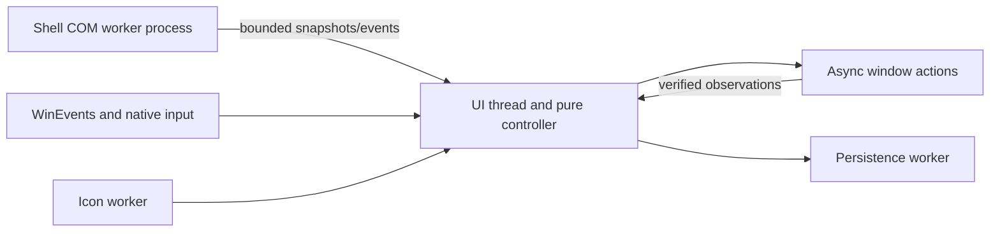

# Architecture

This document defines the current design. Implementation status and remaining work
are tracked in [Status and roadmap](Status-and-Roadmap.md); completed evidence is in
[Testing](Testing.md).

## Product contract and boundaries

The utility is a native, per-user Windows 11 x64 application. A 25-DIP AppBar reserves
the primary display's left edge (releasing that work-area reservation on exit, where standard Win32 work-area updates may shift windows anchored to workspace coordinates). Desktop dots precede one icon-only button per eligible
shared window. Light switch, pause and Settings controls occupy the bottom, with a separate Exit
button below Settings. The current desktop uses a larger filled dot; inactive desktops
use colored outlines. Application icons have solid/outlined visibility indicators
beneath. There are no window-title labels/tooltips, context menus, pinning
controls, or overflow UI. The intended inventory is about two or three windows.

Manage ordinary windows pinned individually OR covered by application-level pinning.
Taskbar pins do not qualify. Include minimized windows; exclude the rail, shell surfaces,
child/helper windows, and owned dialogs as independent entries. A dialog belongs to its
owner's interaction group. Unsupported/inaccessible windows are omitted.

| Situation | Window policy |
| --- | --- |
| Confirmed desktop switch, default mode | Minimize visible managed windows; preserve layout memory. |
| Switch with `auto_restore` enabled | Keep user-minimized destinations minimized; otherwise restore saved destination layouts without focus, or minimize windows with no destination layout. |
| Incompatible live Snap during automatic restore | With default-on `minimize_snapped_elsewhere`, minimize without placement or foreground; disabling it retains the decline-and-notice policy. Matching saved Snap arrangements may still restore. |
| Rail click, minimized | Restore destination layout, or last usable clamped fallback, then request guarded focus. |
| Rail click, visible background group | Bring the group forward. |
| Rail click, foreground group | Minimize through its owner. |
| Pause | Suspend automatic minimize and restore; manual actions, dots and discovery continue. |
| Startup, discovery, recovery, resume, setting change | Establish a baseline without immediate visibility changes. |

Move/resize and reliable normal/maximized-state changes update desktop memory.
Verified manual rail restoration also establishes the destination layout, except
for temporary `RevealSnap` requests under the Snap minimization preference. External
minimize-to-visible restoration is manual intent only on a stable desktop, outside
drags and our pending/late operations: require matching reachable geometry observations
at least 100 ms apart. Reject transient off-screen coordinates. Automatic restoration
never rewrites saved geometry or the last-usable fallback. Minimization retains memory.

An external restore first observed during a drag, or immediately before it, retains
its observation through the drag. Drag snapshots cannot clear minimized intent;
drag start/end reset the stability interval, and only subsequent reachable, matching
visible observations can clear it. Late drag-end captures cannot backdate that interval.
A current verified minimize retains completion provenance until its first fresh
snapshot. If that snapshot is already visible, it may start an external-restore
candidate despite normal post-action suppression; committing still requires 100 ms
of matching reachable observations. Late, timed-out, cancelled or superseded actions,
pending work and recovery/desktop baselines cannot authorize this exception.
Equal-timestamp snapshots do not advance or discard a pending restore candidate or
replace its cached visibility/geometry. Context invalidation still applies even when
the tick is unchanged, including pending actions and coalesced desktop transitions.

Each record separately stores a default-empty `minimized_desktops` set. Verified
current explicit minimization and eligible external visible-to-minimized observations
set this intent; verified current explicit restoration and stable external restoration
clear it only for the current desktop. Automatic actions never modify it. Remember
minimized intent even without saved geometry and continue observing manual changes
while paused. Initial/recovery observations do not infer intent. Windows does not
identify a person versus application as the source of an external minimize.

Native minimize-start/end WinEvents supplement snapshots. Minimize-start evidence is
identity-validated and sampled between matching current-desktop queries in the shell
worker, before processing any queued rail switch. Generation, transition serial,
sequence and timestamps gate acceptance; pending/late operations, drags, stale events
and ambiguous transitions cannot establish intent. Newer state evidence wins over
older queued snapshots. If an external desktop switch outruns both the native evidence
and the stable snapshot, attribution is deliberately rejected rather than guessed.

## Stack and source map

Rust with the pinned MSVC x64 toolchain, selected `windows` crate bindings, native
Win32 controls and GDI painting, `winvd = 0.0.49`, and versioned JSON storage. Static
CRT and an unpackaged portable executable avoid a managed runtime, service, or driver.
Core usage is local; diagnostics are bounded and do not collect window titles. Settings
can create a user-selected ZIP locally. Its report uses temporary window/desktop labels,
freshly observes still-matching managed windows off the UI thread, and includes bounded
redacted event history. It omits titles, document content, HWNDs, PIDs, full executable
paths, desktop names/IDs and screenshots; it does not upload anything. Native Snap Group
membership is not exposed to the app and therefore is not reported.

Application icons are painted at 16 DIPs (16/20/24/32 pixels at 100/125/150/200%).
The icon worker prefers size-specific executable extraction, then class icons,
then window icons, with the generic UI icon as the final fallback. Within each
runtime source it chooses an exact-size image, otherwise the smallest image large
enough, otherwise the largest available. Icons are captured once per cache entry;
there is no periodic refresh. WIC Fant filtering normalizes mismatched images once
off the UI thread, preserving premultiplied alpha. Cache keys include window identity and DPI;
extraction or WIC failure retains the existing fallback behavior. Applications that
provide only small artwork can still require enlargement.

| Path | Responsibility |
| --- | --- |
| `crates/rail-core/src/{lib,layout,saved,operation,admission,model}.rs` | Pure controller: identity/layout data, persisted memory, operation lifecycle, observation admission and policy |
| `crates/rail-core/tests/controller.rs` | Named controller regression scenarios and seeded event-sequence invariant checks |
| `apps/rail/src/main.rs` | GUI/CLI entry, command delivery and integration-worker mode |
| `apps/rail/src/ui.rs` | Native controls, paint/input, WinEvents, settings and orchestration |
| `apps/rail/src/theme.rs` | Per-user Windows app/system color-mode writes and off-UI change notification |
| `apps/rail/src/appbar.rs` | Work-area reservation, fullscreen/z-order and shell recovery |
| `apps/rail/src/platform.rs` | OS eligibility, window properties, candidates, identity and geometry |
| `apps/rail/src/bridge.rs` | Shell COM subprocess, bounded protocol, watchdog, backoff and JobObject |
| `apps/rail/src/actions.rs`, `actions/tests.rs` | Async action executor over an injected native window/clock interface, verification, quarantine, guarded focus and executor/controller harness regressions |
| `apps/rail/src/store.rs` | Atomic storage, backup/recovery, session merges, bounded diagnostics/report archive and Startup shortcut |
| `apps/rail/src/icons.rs`, `metrics.rs` | Off-UI icon extraction/cache and bounded dispatch statistics |
| `apps/rail/src/singleton.rs`, `native.rs` | Session instance coordination and small raw Win32 declarations |
| `apps/rail/build.rs`, `apps/rail/rail.manifest` | Cargo-derived version resources, source provenance, embedded icons and generated PerMonitorV2/asInvoker/long-path manifest |
| `tools/compatibility-probe` | Read-only probe and explicit fixture/desktop exercises |
| `tools/native-smoke`, `tools/fullscreen-smoke` | Ordinary duplicate/modal/stalled-window and fullscreen fixtures |

Settings includes **Save diagnostic report…** beside Retry. The UI snapshots report
context, then releases its model borrow before opening the local ZIP save dialog; its
nested message loop continues processing wake/events. Fresh managed-window observations
and archive writing run on the storage worker. The bounded `diagnostics-events.jsonl` history records desktop aliases,
window aliases, accepted/completed action evidence, integration readiness and selected
setting changes without persistent window or desktop identifiers. `--status` remains a
separate live-instance snapshot and may contain identifiers; it is not copied to the
support archive.

The Settings footer places the integration indicator and status above a
10-DIP version label in the system gray text color. The label aligns with the status
text; Done is centered beside the combined group. The compact Settings window is
526 DIP high, including both Appearance preferences. Status and notices use separate controls. A measured read-only notice area
expands the window only while populated; oversized details remain selectable and
vertically scrollable. Relayout preserves controls/focus, clamps to the work area,
and redraws children. The timeout notice clears when no quarantined action remains.
See [Testing](Testing.md#compatibility-and-completed-validation) for scoped verification.

Build identity is compiled once per build and shared by Settings, local `--version`
(and `--version --json`) and the additive `build` object in schema-1 `--status`.
Status describes the running instance; version commands describe the invoked image
without singleton acquisition or shell integration. See [Development](Development.md)
for provenance refresh and release-package gates.

## Ownership and responsiveness

The UI owns decisions and runs a blocking Win32 message loop. Callbacks enqueue work
and return. Shell COM, disk I/O, icon extraction and blocking target messages stay off
the UI thread. Queues, observations and diagnostics are bounded; geometry events are
coalesced. Do not transfer raw COM interfaces between apartments without marshaling.

Shell integration runs in an owned subprocess because a thread deadline cannot cancel
a stuck COM call. Watchdogs, bounded IPC, reconnect backoff and a kill-on-parent-close
JobObject bound failures. Worker startup validates its same-image, same-session parent.
Library notification registration is asynchronous: a returned thread handle alone
does not establish successful event delivery.

## Desktop integration and eligibility

The product and probe share `OsVersion::meets_adapter_minimum`: Windows version 10.0,
build above 26100, or build 26100 with revision at least 2605. The target is Windows 11
x64. Both worker startup and reconnect check this boundary before initialization.
Legacy `experimental_integration` storage/status/CLI remains accepted but has no effect
on eligibility; its Settings checkbox is removed.

**Eligibility is not certification.** Initialization and runtime queries must succeed.
Keep tested OS revisions as scoped evidence in [Testing](Testing.md), not as a hidden
allowlist. The public `IVirtualDesktopManager` lacks the required switching, pinning
and notification API surface, so internal shell dependencies stay behind our adapter.
`EVENT_SYSTEM_DESKTOPSWITCH` concerns Win32 desktops, not virtual-desktop identity.
Layout keys are desktop GUIDs; ordinal positions are display/navigation data only.

At startup/reconnect, enumerate candidates; reconcile shell/window events, poll cached
candidates once per second and perform a 30-second safety rescan. Pin queries are an
OR, not exclusive states. Only **both** queries returning `WindowNotFound` means no
shell ApplicationView and an unsupported candidate. When `is_pinned_window` succeeds (`Ok(true)` or `Ok(false)`) and `is_pinned_app` returns `ComError(HRESULT(0x80070490))` (`ERROR_NOT_FOUND` from `GetAppIdForWindow` when a valid `IApplicationView` has no shell `AppUserModelId`, such as `MMCMainFrame`), the candidate is `Observed` as not application-pinned. Mixed/other errors remain failures;
revalidate candidate lifetime after queries. Do not mask arbitrary COM errors.

Ready/reconnecting/unavailable status is independent of pause. Untrusted desktop identity
or pin eligibility disables dependent controls and layout attribution while settings,
pause, retry and exit remain usable. The Play/Pause warning icon/tooltip and Settings
footer explain status. Recovery takes a fresh baseline without moving windows.
`TaskbarCreated` re-registers the AppBar and reconnects integration.

## Layout identity, storage and action ordering

Persist an opaque non-pointer window property token with process creation time,
executable identity and session. Revalidate before acting: HWNDs are reusable and are
not persistent identities. Tokens distinguish identical live windows across rail
restarts. Application restarts get fresh records; executable/class/title/order matching
is insufficient evidence for reassociation. A token is an identity hint, not authorization.
Normal window destruction removes properties; values must not own allocated resources.

Separate layout memory from actual visibility. Store normal restore rectangle,
optional visible screen bounds and arranged-state
evidence, normal/maximized state, desktop GUID and monitor/DPI/work-area context;
retain last usable geometry separately. Clamp to available work areas on restore.
Placement/workspace coordinates need conversion before screen-coordinate operations.
Startup observations must not overwrite saved geometry changed while the rail was stopped.

### Native Snap preservation

Native group membership is not stored or reconstructed. Arranged-state detection is
resolved once from user32; unavailable support is unknown. Saved visible bounds are
separate from normal restore bounds, and minimized parking rectangles are not learned.
Legacy layouts without this evidence do not establish a Snap arrangement.

Before minimizing, the action worker queries live arranged-state evidence and uses
`ShowWindowAsync(SW_MINIMIZE)` for snapped windows. Ordinary windows retain
`SW_SHOWMINNOACTIVE`. No placement is written by either minimize path.

For a matching saved live arrangement with compatible display context and restore
bounds, a minimized window receives only `ShowWindowAsync(SW_SHOWNOACTIVATE)`;
a visible match receives no show/placement command. Saved evidence can select a reveal
candidate when native arranged state is false while minimized. Completion still requires a visible window,
matching visible and restore bounds and matching native state. A stale arranged flag
or normal bounds alone do not establish success. `SW_SHOWNOACTIVATE` reveals a
minimized arrangement without activation; `SW_SHOWNA` can leave it minimized, and
`SW_RESTORE` would activate before the guarded-focus check. See the native evidence
in [Troubleshooting](Troubleshooting.md#snapped-restoration-reports-success-at-the-wrong-visible-size).
Incompatible saved Snap arrangements, including after changed topology, are not
restored through placement. A currently arranged window also cannot receive ordinary saved
placement. These guards preserve native state rather than attempting reconstruction
with `SetWindowPlacement`, `SetWindowPos` or `MoveWindow`.

The live identity record also retains confirmed visible Snap evidence across
minimization, when Windows may report arranged=false. This evidence is independent
of saved destination history, is passed with requests, and prevents an ordinary
placement from breaking a retained arrangement. A fresh confirmed visible unsnapped
observation clears it; display-context changes or identity replacement invalidate it.
The worker delivers identity-validated pre-minimize layout evidence with its native
sample timestamp, independently of API acceptance or action verification. This
covers a snap newer than the controller snapshot even when a desktop switch, newer
intent or timeout supersedes the minimize before completion. Such evidence updates
only the live identity cache; it cannot commit desktop memory, minimized intent,
notice recovery or focus. Minimize completion never re-dates its old pre-dispatch
layout as if it were a new observation.

The cache tracks latest display context separately from the last definitive visible
arranged/unsnapped observation or context/identity boundary. A delayed visible native
sample can fill retained evidence through newer minimized/unknown observations
(including a same-tick minimized sample) in the same display context. It must be
strictly newer than that definitive boundary. A still-current request can prove
its subsequent native query followed a baseline with the same coarse clock tick,
but only if its definitive-evidence revision is unchanged. This exception cannot
override post-request observations or duplicate reports. Newer/equal known visible state,
drag captures, context changes (even if the display context returns later), identity
replacement and removal fence old evidence. HWND, PID and full live identity must
still match. Snapshot admission still prevents equal-tick repeats and older snapshots
from clearing newer identity-validated captures.
Fresh visible native state takes precedence over retained minimized evidence at
dispatch. A minimized window with restore-to-maximized state cannot qualify for a
Snap reveal, even when its normal restore bounds match. Under the decline policy,
both mismatches use the
existing Snap notice and reject before any show/placement command, releasing the
pending action rather than entering verification/quarantine. User-minimized
destinations still produce no automatic restore request.

`minimize_snapped_elsewhere` defaults true, including when absent from schema-1
configuration. It changes confirmed desktop-switch actions only; pause, startup,
recovery and preference changes retain the fresh-baseline/no-immediate-action rule.
The executor checks fresh live and identity-scoped retained Snap evidence at dispatch.
When automatic restoration cannot preserve that arrangement on the saved destination,
it executes a verified minimize rather than placement/reveal or a mismatch notice.
Already-iconic mismatches need no show command. A saved Snap target alone, without
live/retained evidence, cannot trigger this fallback. Automatic work never changes
saved geometry or user-minimized intent. Settings changes invalidate queued automatic
tickets, while pending native work still settles under the existing late-result rules.

Explicit rail restoration remains available: with the option enabled and retained
native evidence, `RevealSnap` reveals/verifies the live arrangement without placement,
then requests guarded focus. It clears current-desktop minimized intent but preserves
destination geometry and last-usable memory, so a temporary manual reveal does not
turn an ordinary destination into a Snap restoration target. Fresh visible unsnapping
clears retained evidence and restores ordinary behavior. Native Snap restore bounds
may extend outside the work area: placement-free matching compares those original
bounds rather than clamping them. Display context and visible-result checks still apply.

The existing Snap preservation notice carries the rejected request's live identity
(including HWND/PID), target and dispatch timestamp. Only a current, non-quarantined
verified restore/raise for that identity clears it; acceptance, unrelated success,
superseded sequences/generations and late completion do not. A stable-desktop,
identity-validated snapshot can also clear it, with no pending action or drag, only
when its timestamp exceeds the rejection, prior snapshot and all accepted state,
capture and action evidence. The window must be non-minimized with visible bounds.
For a saved Snap target, native arranged=true, normal/visible bounds, maximized state
and original monitor/work-area/DPI context must match the existing preservation and
verification predicates. For an ordinary target, native arranged=false and matching
display-adjusted normal/visible bounds and maximized state are required. Visibility
alone, unknown arranged state or an unchanged mismatch cannot clear it. Clearing
does not rewrite saved layouts. Authoritative inventory removal/replacement or a
matched identity-lost result clears the affected notice; pending identities survive
temporary inventory omission. Clearing never erases a different displayed notice,
and report-picker cancellation cannot resurrect a Snap notice cleared while covered.
The timeout notice retains its existing independent quarantine lifecycle.

### Storage and action sequencing

Schema 1 JSON under LocalAppData defaults missing `auto_restore` to false and missing
`minimize_snapped_elsewhere` to true; explicit false survives restart and cross-session
preference merges. Storage is
bounded to 4 MiB, 512 identities and 64 distinct remembered desktop IDs per identity
(the union of layouts and minimized intent). Missing minimized sets default empty;
deleted desktops are pruned from both. At the identity cap new
identities are omitted. Ordered debounced writes use atomic replacement, previous-state
recovery, corrupt-file preservation and coordinated cross-session merges. Shutdown
flush is bounded. Startup is an opt-in per-user shortcut; a named user/session mutex
prevents a second AppBar/controller, while `--settings` addresses the existing instance.

Each window has a generation, monotonic sequence, latest intent, and at most one
unverified operation (`Queued`, `Accepted`, or `Quarantined`). The controller owns
policy and latest intent; the action executor owns native dispatch progress and
verification evidence, reporting `Acceptance` separately from the settling `Outcome`
(`Verified`, `Rejected`, `IdentityLost`, `TimedOut`, `Busy`). The original request is
never rewritten: user intent governs whether memory and focus may change, while the
verified execution target (display-adjusted, or observed when a restore converts to a
raise) governs which layout is committed. Automatic restore may execute minimize
under the Snap policy; cached visibility follows the verified execution effect while
the original intent still controls memory/focus. Revalidate identity, desktop, pause and drag
state before dispatch. New destinations supersede stale queued work; current clicks can
supersede queued minimization. Coalesced A→B→A events still represent a transition.
Timestamped drag and snapshot observations must not commit stale or unreachable
geometry to the wrong desktop.

API acceptance is not completion. Verify actions with a two-second deadline; timeout
quarantines the operation until observed or its identity dies. Never release the slot
merely because the window temporarily disappears or a partial dispatch fails. Cancellation
removes undispatched work only. Late actions cannot commit geometry or steal focus;
reconcile once toward still-valid latest intent, including minimizing a late restore
on a destination without a layout. Do not build an unbounded retry backlog or fight a drag.

For ordinary placements, automatic restoration sets placement while minimized, preserves
`WPF_RESTORETOMAXIMIZED`, then reveals with `SW_SHOWNOACTIVATE`; it never requests
foreground. Because `SW_SHOWNOACTIVATE` raises newly revealed windows, runtime
Z-order memory is desktop-specific. Fresh idle snapshots and current explicit-minimize
samples record peers above each window; automatic post-switch minimize samples do not
replace the outgoing history. Learning is suspended across all pending managed actions,
including quarantine, and resumes only with snapshots strictly newer than the last
completion. Equal-timestamp observations cannot replace the order.

Automatic restores place each window and its modal behind the lowest currently eligible
saved peer, using Z-order-only nonactivating `SetWindowPos`. With no saved eligible peer,
an independent foreground window is the fallback; an actively restored managed window
cannot be a fallback dependency. The executor observes and reconciles the full current
automatic-restore cohort before releasing any member, requiring two successful polls of
the whole cohort. It retries a disturbed, previously observed correction but does not
repeatedly enqueue the same unapplied correction. Timed-out/superseded work remains
observational under the existing late-result rules. Explicit actions retain arrival
ordering, and explicit foreground actions/drag commits clear only the current desktop's
Z-order memory. Explicit restoration may request focus only while its original user intent
remains valid. A minimized HWND wins over stale foreground reports. Active owned dialogs
are revealed/focused with the owner, never given separate layouts or buttons. Never
bypass focus restrictions with synthetic Alt or thread-input attachment.

## Rail presentation

The current desktop name is painted bottom-to-top above the utility divider in
11-DIP, antialiased Segoe UI, optically centered across the rail with muted foreground color
(system foreground in high contrast). A DPI-cached supersampled rasterizer and measured full
text extents keep it clear of desktop/window buttons with 12-DIP gaps. If its full
length or thickness cannot fit, or the current desktop is unknown, it is omitted
without truncation. Empty names use the same numbered fallback as desktop tooltips.
It shares the rail's invalidation and reveal transform and adds no input target.
The rasterizer flushes GDI drawing before reading DIB memory so queued text output
cannot be sampled as an empty mask and cached as an invisible label.
**Appearance → Show desktop name** controls visibility immediately. The default-on
`show_desktop_name` preference defaults to true for older schema-1 files, persists
explicit opt-outs, and participates in revision-based cross-session preference merges.

Desktop dots retain left-click switching. Right-click (or F2 on a focused dot) opens
a modeless 280-DIP rename popover beside that dot, clamped to its monitor work area,
without switching desktops. The existing name is selected; Enter/Rename submits,
Escape/Cancel/deactivation dismisses, and native dialog navigation supplies Tab.
The editor uses DWM rounded corners, native system colors, and a collapsible status row
that expands the popover only while showing progress or an error. It does not expand the AppBar.

The UI validates a trimmed, nonempty, single-line name bounded to 256 UTF-16 code
units and sends a GUID-targeted rename to the isolated integration subprocess.
The worker validates again, invokes `winvd::Desktop::set_name`, and reads the name
back before returning success. No shell call runs on the UI thread. The next frame
refreshes desktop tooltips and accessible button names, including external renames.
Errors preserve the entered text; queue/integration failures are retryable. Per-request
tokens prevent stale replies from dismissing a newer edit. Dismissal after submission
does not cancel a shell operation already in progress. Names are owned by Windows,
not duplicated in rail storage or diagnostic history.

The bottom light switch sets both `AppsUseLightTheme` and `SystemUsesLightTheme`
under the current user's Windows `Themes\Personalize` key, choosing the opposite
of the current app mode. Its sun/moon glyph shows the destination mode, matching its
tooltip and accessible name. No appearance preference is stored in rail state. A short-lived
worker writes and reads back the values, then broadcasts `WM_SETTINGCHANGE` with
`ImmersiveColorSet` using a per-recipient timeout. The button is disabled while busy;
completion refreshes its accessible name/tooltip, and failures open the Settings notice.
If the app-mode write fails after the system-mode write, the previous system mode is
restored where possible. Registry readback establishes preference persistence, not
that every running application rendered the new mode. High-contrast painting remains
governed by system accessibility colors.

The default-off `desktop_tint` preference blends the active desktop dot color into
the rail background (18% in dark theme, 14% in light theme), including owner-drawn
button backgrounds and the header. The shared paint helper retains the neutral
background when no current desktop is known and preserves system high-contrast
colors. Desktop changes and preference changes invalidate the rail and its buttons.
The preference is backward-compatible in schema 1 and participates in revision-based
cross-session preference merges; changing it does not alter controller actions.

A reduced, muted 14-DIP header badge with a divider precedes the desktop dots; a bottom
divider separates the window buttons from the compact muted utility icons (Light switch,
Play/Pause, Settings, Exit). Owner-drawn buttons track mouse hover (`TrackMouseEvent`), pressed
state, and keyboard-only focus (`:focus-visible` behavior) to paint rounded highlight
surfaces and brighten utility glyphs on interaction without leaving sticky focus rings
after passive mouse clicks. Under-icon visibility indicators use DPI-scaled anti-aliased
pills (solid accent when visible, muted outline when minimized). When button geometry is
unchanged, reuse native button HWNDs and synchronize their Win32 captions as well as
tooltips when labels change, keeping accessibility names current across desktop, name
and pause/status updates.

AppBars reserve work area but do not constrain manually positioned or fullscreen
windows. Per-Monitor V2 and display/DPI notifications govern rail geometry; fullscreen
foreground yields z-order without activation and normal foreground restores topmost.

The rail enables DWM Peek exclusion (`DWMWA_EXCLUDED_FROM_PEEK`) only while Task View is
open so the rail stays stationary and visible during normal desktop switches while
omitting it from Task View desktop thumbnails, remaining capturable in screenshots/screen
sharing. A 200-ms cubic ease-out slides artwork and native buttons in from the left after
Task View dismissal. The AppBar HWND, bounds and work-area reservation stay fixed: a
temporary region clips translated content and is removed at completion. One transient
16-ms timer serves reveal; late ticks advance to current elapsed time. Windows'
client-area animation preference disables the effect, including when it cannot be read.
Size/DPI/settings changes, retry/unavailability and shutdown cancel presentation.
Startup/recovery and ordinary desktop switches do not hide or animate the rail.
Presentation never delays controller actions, changes memory or requests focus.

Task View return is recognized with or without a desktop change. Discovery requires a
foreground, visible, uncloaked fullscreen `XamlExplorerHostIslandWindow` or
`MultitaskingViewFrame` in the `GetShellWindow` process. As soon as foreground leaves the
Task View host (or it hides/cloaks), the reveal starts immediately without waiting for
delayed host cloaking. The shared Alt+Tab host can receive the same effect. While visible,
it enables `DWMWA_EXCLUDED_FROM_PEEK` and holds the rail clipped without a reveal timer;
disappearance starts the reveal. These shell classes are compatibility hints, not desktop
identity. There is no background-host discovery, localized-title matching or extra
periodic poll. Current trigger limits are in [Status](Status-and-Roadmap.md#known-defects-and-unmet-behavior).

## Decisions and rationale

| Decision | Rationale and rejected approach |
| --- | --- |
| Native controls, invalidation-driven paint, cached icons | Keep idle cost small; no browser runtime, animation loop or permanent frame timer. A bounded slide-in timer runs only after shell-switcher dismissal. Existing reconciliation is the measured polling exception. |
| Peek exclusion with a bounded slide-in | Preserve Task View thumbnail exclusion and capture behavior; presentation is independent of layout/focus policy and inherits shell timing limits. |
| AppBar protocol with passive tool-window style | Negotiate work area instead of globally writing it. Presence across desktops must be tested; being an AppBar alone does not guarantee it. |
| Process-isolated shell adapter | A deadline cannot cancel COM; unlimited replacement threads would leak blocked work. |
| Generation/sequence and completion tracking | A Boolean around native calls cannot distinguish delayed work, rapid switches and user edits. |
| Strong live-window identity | Avoid applying layouts to the wrong duplicate after handle reuse or application restart. |
| Stable external-restore observations | Manual Windows restores should establish memory without learning minimized/off-screen intermediate coordinates. |
| Minimum-build eligibility plus runtime failure handling | Replace restrictive revision opt-ins without claiming every eligible revision is validated. |
| Per-user portable distribution and Startup shortcut | No service, driver or installation elevation required; signing/installer work is undecided. |

## API references

These references explain the API choices; they do not certify product behavior.

- [VirtualDesktopAccessor / winvd](https://github.com/Ciantic/VirtualDesktopAccessor)
- [Rust for Windows](https://microsoft.github.io/windows-docs-rs/doc/windows/index.html)
- [IVirtualDesktopManager](https://learn.microsoft.com/en-us/windows/win32/api/shobjidl_core/nn-shobjidl_core-ivirtualdesktopmanager)
- [Application desktop toolbars](https://learn.microsoft.com/en-us/windows/win32/shell/application-desktop-toolbars)
- [SetForegroundWindow](https://learn.microsoft.com/en-us/windows/win32/api/winuser/nf-winuser-setforegroundwindow)
- [SetWinEventHook](https://learn.microsoft.com/en-us/windows/win32/api/winuser/nf-winuser-setwineventhook) and [callback reentrancy](https://learn.microsoft.com/en-us/windows/win32/winauto/guarding-against-reentrancy-in-hook-functions)
- [WINDOWPLACEMENT coordinate rules](https://learn.microsoft.com/en-us/windows/win32/api/winuser/ns-winuser-windowplacement)
- [High DPI desktop development](https://learn.microsoft.com/en-us/windows/win32/hidpi/high-dpi-desktop-application-development-on-windows)
- [IsWindowArranged](https://learn.microsoft.com/en-us/windows/win32/winmsg/winuser/nf-winuser-iswindowarranged) and [ShowWindow](https://learn.microsoft.com/en-us/windows/win32/api/winuser/nf-winuser-showwindow)
- [Window-property cleanup](https://devblogs.microsoft.com/oldnewthing/20231030-00/?p=108939)

## Design references

[Original HTML mockup](assets/desktop-rail.html) explores the narrow rail and icon-only
layout; [colorways](assets/colorways.png) and [small preview](assets/small-preview.png)
retain the dot-color exploration. These are historical design references, not screenshots
or a current UI specification. The contract above and live app verification take precedence.
