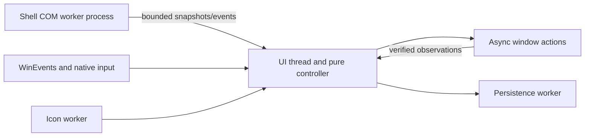

# Architecture

Current design, reconciled against the implementation on 2026-11-02. Implementation
and release coverage are tracked in [Status and roadmap](Status-and-Roadmap.md).

## Product contract and boundaries

The utility is a native, per-user Windows 11 x64 application. A 25-DIP AppBar reserves
the primary display's left edge. Desktop dots precede one icon-only button per eligible
shared window. Settings and pause controls occupy the bottom, with a separate Exit
button below Settings. The current desktop uses a larger filled dot; inactive desktops
use colored outlines. Window icons remain unchanged, with solid/outlined visibility
indicators beneath. There are no window-title labels/tooltips, context menus, pinning
controls, or overflow UI. The intended inventory is about two or three windows.

Manage ordinary windows pinned individually OR covered by application-level pinning.
Taskbar pins do not qualify. Include minimized windows; exclude the rail, shell surfaces,
child/helper windows, and owned dialogs as independent entries. A dialog belongs to its
owner's interaction group. Unsupported/inaccessible windows are omitted.

| Situation | Window policy |
| --- | --- |
| Confirmed desktop switch, default mode | Minimize visible managed windows; preserve layout memory. |
| Switch with `auto_restore` enabled | Restore each saved destination layout without focus; minimize windows with no destination layout. |
| Rail click, minimized | Restore destination layout, or last usable clamped fallback, then request guarded focus. |
| Rail click, visible background group | Bring the group forward. |
| Rail click, foreground group | Minimize through its owner. |
| Pause | Suspend automatic minimize and restore; manual actions, dots and discovery continue. |
| Startup, discovery, recovery, resume, setting change | Establish a baseline without immediate visibility changes. |

Move/resize and reliable normal/maximized-state changes update desktop memory.
Verified manual rail restoration also establishes the destination layout. External
minimize-to-visible restoration is manual intent only on a stable desktop, outside
drags and our pending/late operations: require matching reachable geometry observations
at least 100 ms apart. Reject transient off-screen coordinates. Automatic restoration
never rewrites saved geometry or the last-usable fallback. Minimization retains memory.

## Stack and source map

Rust with the pinned MSVC x64 toolchain, selected `windows` crate bindings, native
Win32 controls and GDI painting, `winvd = 0.0.49`, and versioned JSON storage. Static
CRT and an unpackaged portable executable avoid a managed runtime, service, or driver.
Core usage is local; diagnostics are bounded and do not collect window titles.

| Path | Responsibility |
| --- | --- |
| `crates/rail-core/src/lib.rs` | Pure controller, layout/identity model, generations, sequencing, pause and recovery |
| `crates/rail-core/tests/controller.rs` | Controller regression scenarios |
| `apps/rail/src/main.rs` | GUI/CLI entry, command delivery and integration-worker mode |
| `apps/rail/src/ui.rs` | Native controls, paint/input, WinEvents, settings and orchestration |
| `apps/rail/src/appbar.rs` | Work-area reservation, fullscreen/z-order and shell recovery |
| `apps/rail/src/platform.rs` | OS eligibility, window properties, candidates, identity and geometry |
| `apps/rail/src/bridge.rs` | Shell COM subprocess, bounded protocol, watchdog, backoff and JobObject |
| `apps/rail/src/actions.rs` | Async actions, verification, quarantine and guarded focus |
| `apps/rail/src/store.rs` | Atomic storage, backup/recovery, session merges, diagnostics and Startup shortcut |
| `apps/rail/src/icons.rs`, `metrics.rs` | Off-UI icon extraction/cache and bounded dispatch statistics |
| `apps/rail/src/singleton.rs`, `native.rs` | Session instance coordination and small raw Win32 declarations |
| `apps/rail/build.rs`, `apps/rail/rail.manifest` | Cargo-derived version resources, source provenance, embedded icons and generated PerMonitorV2/asInvoker/long-path manifest |
| `tools/compatibility-probe` | Read-only probe and explicit fixture/desktop exercises |
| `tools/native-smoke`, `tools/fullscreen-smoke` | Ordinary duplicate/modal/stalled-window and fullscreen fixtures |

The Settings footer places the integration indicator and two-line status above a
10-DIP version label in the system gray text color. The label aligns with the status
text; Done is centered beside the combined group. The compact Settings window is
380 DIP high, retaining room for a second status/notice line.

Build identity is compiled once per build and shared by Settings, local `--version`
(and `--version --json`) and the additive `build` object in schema-1 `--status`.
Status describes the running instance; version commands describe the invoked image
without singleton acquisition or shell integration. See [Development](Development.md)
for provenance refresh and release-package gates.

## Ownership and responsiveness

The UI owns decisions and runs a blocking Win32 message loop. Callbacks enqueue work
and return. Shell COM, disk I/O, icon extraction and blocking target messages stay off
the UI thread. Queues, observations and diagnostics are bounded; geometry events are
coalesced. Do not transfer raw COM interfaces between apartments without marshaling.

Shell integration runs in an owned subprocess because a thread deadline cannot cancel
a stuck COM call. Watchdogs, bounded IPC, reconnect backoff and a kill-on-parent-close
JobObject bound failures. Worker startup validates its same-image, same-session parent.
Library notification registration is asynchronous: a returned thread handle alone
does not establish successful event delivery.

## Desktop integration and eligibility

The product and probe share `OsVersion::meets_adapter_minimum`: Windows version 10.0,
build above 26100, or build 26100 with revision at least 2605. The target is Windows 11
x64. Both worker startup and reconnect check this boundary before initialization.
The former exact 26300.9457 allowlist and newer-26300 experimental opt-in are superseded.
Legacy `experimental_integration` storage/status/CLI remains accepted but has no effect
on eligibility; its Settings checkbox is removed.

**Eligibility is not certification.** Initialization and runtime queries must succeed.
Keep tested OS revisions as scoped evidence in [Testing](Testing.md), not as a hidden
allowlist. The public `IVirtualDesktopManager` lacks the required switching, pinning
and notification API surface, so internal shell dependencies stay behind our adapter.
`EVENT_SYSTEM_DESKTOPSWITCH` concerns Win32 desktops, not virtual-desktop identity.
Layout keys are desktop GUIDs; ordinal positions are display/navigation data only.

At startup/reconnect, enumerate candidates; reconcile shell/window events, poll cached
candidates once per second and perform a 30-second safety rescan. Pin queries are an
OR, not exclusive states. Only **both** queries returning `WindowNotFound` means no
shell ApplicationView and an unsupported candidate. Mixed/other errors remain failures;
revalidate candidate lifetime after queries. Do not mask arbitrary COM errors.

Ready/reconnecting/unavailable status is independent of pause. Untrusted desktop identity
or pin eligibility disables dependent controls and layout attribution while settings,
pause, retry and exit remain usable. The Play/Pause warning icon/tooltip and Settings
footer explain status. Recovery takes a fresh baseline without moving windows.
`TaskbarCreated` re-registers the AppBar and reconnects integration.

## Layout identity, storage and action ordering

Persist an opaque non-pointer window property token with process creation time,
executable identity and session. Revalidate before acting: HWNDs are reusable and are
not persistent identities. Tokens distinguish identical live windows across rail
restarts. Application restarts get fresh records; executable/class/title/order matching
is insufficient evidence for reassociation. A token is an identity hint, not authorization.
Normal window destruction removes properties; values must not own allocated resources.

Separate layout memory from actual visibility. Store normal rectangle, normal/maximized
state, desktop GUID and monitor/DPI/work-area context; retain last usable geometry
separately. Clamp to available work areas on restore. Placement/workspace coordinates
need conversion before screen-coordinate operations. Snap groups are outside the contract.
Startup observations must not overwrite saved geometry changed while the rail was stopped.

Schema 1 JSON under LocalAppData defaults missing `auto_restore` to false. Storage is
bounded to 4 MiB, 512 identities and 64 layouts per identity. At the identity cap new
identities are omitted. Ordered debounced writes use atomic replacement, previous-state
recovery, corrupt-file preservation and coordinated cross-session merges. Shutdown
flush is bounded. Startup is an opt-in per-user shortcut; a named user/session mutex
prevents a second AppBar/controller, while `--settings` addresses the existing instance.

Each window has a generation, monotonic sequence, latest intent, and at most one
unverified operation. Revalidate identity, desktop, pause and drag state before dispatch.
New destinations supersede stale queued work; current clicks can supersede queued
minimization. Coalesced A→B→A events still represent a transition. Timestamped drag and
snapshot observations must not commit stale geometry to the wrong desktop.

API acceptance is not completion. Verify actions with a two-second deadline; timeout
quarantines the operation until observed or its identity dies. Never release the slot
merely because the window temporarily disappears or a partial dispatch fails. Cancellation
removes undispatched work only. Late actions cannot commit geometry or steal focus;
reconcile once toward still-valid latest intent, including minimizing a late restore
on a destination without a layout. Do not build an unbounded retry backlog or fight a drag.

Automatic restoration sets placement while minimized, preserves
`WPF_RESTORETOMAXIMIZED`, then reveals with `SW_SHOWNOACTIVATE`; it never requests
foreground. Explicit restoration may request focus only while its original user intent
remains valid. A minimized HWND wins over stale foreground reports. Active owned dialogs
are revealed/focused with the owner, never given separate layouts or buttons.

## Decisions and rationale

| Decision | Rationale and rejected approach |
| --- | --- |
| Native controls, invalidation-driven paint, cached icons | Keep idle cost small; no browser runtime, animation loop or permanent frame timer. Existing reconciliation is the measured polling exception. |
| AppBar protocol with passive tool-window style | Negotiate work area instead of globally writing it. Presence across desktops must be tested; being an AppBar alone does not guarantee it. |
| Process-isolated shell adapter | A deadline cannot cancel COM; unlimited replacement threads would leak blocked work. |
| Generation/sequence and completion tracking | A Boolean around native calls cannot distinguish delayed work, rapid switches and user edits. |
| Strong live-window identity | Avoid applying layouts to the wrong duplicate after handle reuse or application restart. |
| Stable external-restore observations | Manual Windows restores should establish memory without learning minimized/off-screen intermediate coordinates. |
| Minimum-build eligibility plus runtime failure handling | Replace restrictive revision opt-ins without claiming every eligible revision is validated. |
| Per-user portable distribution and Startup shortcut | No service, driver or installation elevation required; signing/installer work is undecided. |

AppBars do not force manually positioned or fullscreen windows to respect work area.
Use Per-Monitor V2 and display/DPI notifications for rail geometry. Explicit clicks need
guarded activation; never bypass focus restrictions with synthetic Alt or thread-input
attachment. Fullscreen and real-click pitfalls are documented in [Troubleshooting](Troubleshooting.md).
The rail requests DWM Peek exclusion, not screenshot or screen-sharing exclusion.

## API references

These references explain the API choices; they do not certify product behavior.

- [VirtualDesktopAccessor / winvd](https://github.com/Ciantic/VirtualDesktopAccessor)
- [Rust for Windows](https://microsoft.github.io/windows-docs-rs/doc/windows/index.html)
- [IVirtualDesktopManager](https://learn.microsoft.com/en-us/windows/win32/api/shobjidl_core/nn-shobjidl_core-ivirtualdesktopmanager)
- [Application desktop toolbars](https://learn.microsoft.com/en-us/windows/win32/shell/application-desktop-toolbars)
- [SetForegroundWindow](https://learn.microsoft.com/en-us/windows/win32/api/winuser/nf-winuser-setforegroundwindow)
- [SetWinEventHook](https://learn.microsoft.com/en-us/windows/win32/api/winuser/nf-winuser-setwineventhook) and [callback reentrancy](https://learn.microsoft.com/en-us/windows/win32/winauto/guarding-against-reentrancy-in-hook-functions)
- [WINDOWPLACEMENT coordinate rules](https://learn.microsoft.com/en-us/windows/win32/api/winuser/ns-winuser-windowplacement)
- [High DPI desktop development](https://learn.microsoft.com/en-us/windows/win32/hidpi/high-dpi-desktop-application-development-on-windows)
- [Window-property cleanup](https://devblogs.microsoft.com/oldnewthing/20231030-00/?p=108939)

## Design references

[Original HTML mockup](assets/desktop-rail.html) explores the narrow rail and icon-only
layout; [colorways](assets/colorways.png) and [small preview](assets/small-preview.png)
retain the dot-color exploration. These are historical design references, not screenshots
or a current UI specification. The contract above and live app verification take precedence.
