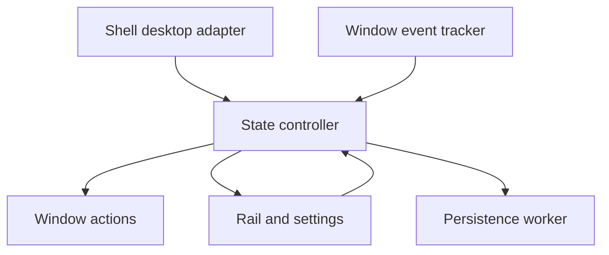

# Virtual Desktop Rail — Implementation Architecture

## Approved automatic-restoration extension — 2026-11-02

The original restore-on-demand policy below remains the default. An opt-in
`auto_restore` preference selects automatic destination-layout restoration:
restore only windows with a saved layout for that desktop; minimize windows
without one. Restoration is automatic intent, so it obeys pause, generations,
per-window sequencing and timeout quarantine, and never requests foreground.
Native automatic restoration establishes minimized restore state, including
`WPF_RESTORETOMAXIMIZED`, then reveals with `SW_SHOWNOACTIVATE`. The intermediate
accepted operation retains its per-window slot even if reveal is declined.

Explicit rail restores now establish destination layouts after verified, current
completion. External minimize-to-visible transitions (including taskbar restores)
are treated as manual intent only within a stable desktop baseline, outside our
pending/late operations and drags. Require matching reachable geometry samples
at least 100 ms apart before saving; reject transient off-screen coordinates.
Automatic restores never rewrite saved geometry or the last-usable fallback.
Startup/recovery/discovery do not learn a layout merely from visibility.
Enabling the preference or resuming does not reveal windows until a new switch.
Already accepted operations cannot be retracted; newer destinations reconcile
after observation, including minimizing a late restore on a desktop without a
layout. Schema 1 adds a default-false field and preserves existing identities.

Companion to [the MVP](Virtual-Desktop-Rail-MVP.md) and [the development environment](Virtual-Desktop-Rail-Dev-Environment.md). This is a proposed implementation, not a tested implementation or a claim of support for every Windows 11 build.

## Stack and support boundary

| Area | Choice | Reason |
| --- | --- | --- |
| Language | Stable Rust, pinned toolchain | Native executable, predictable ownership, no managed runtime requirement |
| Initial target | Windows 11 x64, MSVC toolchain | Keep the first compatibility and packaging matrix small; ARM64 is later |
| Windows bindings | Microsoft's `windows` crate, selected API features | Typed access to Win32 and COM |
| UI | Native Win32 windows and controls; GDI double-buffered paint | Small static rail, no continuous render loop |
| Virtual desktops | `winvd` behind our own adapter | Existing Rust desktop integration; isolate undocumented shell dependencies |
| Storage | Versioned JSON using `serde`/`serde_json` | Small, inspectable local configuration and layouts |
| Logging | Bounded local diagnostic log; `tracing` is a candidate | Troubleshooting without logging every position event or window content |
| Build/release | Cargo, checked-in lockfile, release executable and symbols | Reproducible inputs and straightforward debugging |

Pin dependency versions and the desktop library revision after a compatibility spike. Do not invent a supported-build matrix from the phrase “Windows 11”: select one currently serviced Windows 11 build for initial validation, then add build/revision combinations only after passing tests. The upstream desktop project's README currently names specific minimum/tested builds; that is upstream evidence, not certification of this product. [1][2]

Ship an unpackaged per-user application initially, with no service or driver. Ordinary use runs without elevation. A startup option creates a per-user Startup-folder shortcut. The core application has no network requirement. Code signing and an installer are distribution work to decide before public release.

Enforce one running instance per user session using a named mutex scoped to that user and session. A second launch exits without registering another AppBar or starting another controller.

The MVP assumes approximately two or three managed windows. Rail scrolling and overflow controls are possible later-release work, not an MVP requirement.

## Components and ownership

The UI thread owns the model, rail, settings, and a blocking Win32 message loop. Use the desktop library's required notification thread/COM setup, forwarding typed events to the UI through posted messages and a bounded/coalescing queue. Do not transfer raw COM interface pointers between threads without the appropriate marshaling. Callbacks enqueue work and return; they do not perform layout changes, disk writes, or window enumeration inline.

The UI owns decisions but does not execute potentially blocking shell queries or cross-process window operations. A dedicated integration executor owns desktop adapter calls in the COM apartment supported by the selected library. Keep its notification thread/setup as required by that library. A separate window-action executor dispatches operations and returns observations to the controller. Use `WPF_ASYNCWINDOWPLACEMENT` and `SWP_ASYNCWINDOWPOS` where applicable, together with `ShowWindowAsync`; explicit cross-process message requests use timeout-capable APIs. API acceptance is not verified completion.

A persistence worker handles ordered, debounced writes. Slow metadata/icon extraction must run off the UI and must not indefinitely delay persistence. Requests carry generations and deadlines; late results cannot mutate a newer model. A deadline does not cancel a COM call or an operation already posted to another application. If integration stops responding, disable dependent controls and show unavailable status instead of blocking the UI or creating unlimited replacement workers. Bound queues, coalesce geometry events, and prioritize explicit user requests over background reconciliation.

### Desktop adapter

Expose desktop GUID, ordered desktop list, names, switch requests, pin checks, notifications, and reconnect as a small internal interface. Keep raw undocumented COM and library-specific types out of the controller. Use GUIDs as layout keys; ordinal positions are display/navigation data only.

Microsoft's public `IVirtualDesktopManager` does not expose the complete discovery, switching, pinning, and notification functionality required here. `winvd`/VirtualDesktopAccessor supplies additional capabilities using internal shell interfaces. Do not substitute `EVENT_SYSTEM_DESKTOPSWITCH` as a reliable virtual-desktop notification mechanism: Win32 desktop objects and Windows virtual desktops are different abstractions. [1][3]

Keep library notification registrations alive. On Explorer restart or COM failure, stop issuing window changes, invalidate the current desktop knowledge, reconnect with bounded backoff, enumerate again, and register the AppBar again. Do not equate successful DLL loading or a successful first COM call with ABI compatibility; build validation is necessary.

### Integration status and recovery behavior

Expose `Ready`, `Reconnecting`, and `Unavailable` independently of the user's pause preference. Show a compact status indicator in the settings area with an accessible name and a readable explanation when opened. While desktop identity or pin eligibility is untrusted, disable desktop switching and managed-window actions. Keep settings, pause, retry, and exit available. Cached entries may remain visibly disabled during reconnection; confirmed inaccessible windows are removed.

Suspend layout attribution while the desktop identity is unknown. Recovery establishes a fresh desktop/window baseline and re-registers the AppBar without moving, restoring, or minimizing applications. The next confirmed desktop switch applies automatic minimization only when not paused. Preserve saved layouts and the pause preference. Unsupported builds show a clear explanation and do not repeatedly issue unsafe integration calls.

### Window discovery and pinning

Enumerate windows at startup and reconnection, then maintain the inventory using narrow WinEvents and reconciliation. Eligibility requires an ordinary top-level application window that is pinned individually OR belongs to a pinned application. Include minimized windows. Exclude our process, shell surfaces, child/helper windows, and owned dialogs as independent entries. Avoid filtering all cloaked windows without examination: shell visibility state is not equivalent to window closure.

Validate HWND plus process identity/lifetime before acting; HWNDs can be reused. One rail button represents one eligible window, even when several share the same icon. Closed, unpinned, or inaccessible windows lose their buttons. A transient timeout alone should not be classified as permanent closure.

**Pin/unpin detection is an explicit validation gate.** Upstream exposes separate window/app pin queries, but the documented examples do not establish a complete notification contract for pin-state changes. Investigate the adapter's events on the exact target build. Reconcile on shell/window events, rail interaction, and desktop changes. If that misses pin changes while the system is otherwise idle, use a low-frequency cached candidate check only as a measured fallback, or agree a refresh-delay requirement. Do not promise immediate automatic discovery and zero polling until this is demonstrated. [1]

For the initial release, use a provisional acceptance limit of two seconds for discovering a pin/unpin change in an otherwise idle, responsive session. If notification coverage is insufficient, measure candidate-only reconciliation against the idle CPU goal. Record the interval, discovery latency, and wakeup cost. If both goals cannot be met, revise the requirement explicitly before proceeding.

### Owned dialogs

Keep one button and one saved layout for the eligible owner window. Treat its visible active modal dialog as part of the interaction group: foreground membership includes the owner or active dialog. A click while the group is foreground minimizes through the owner; otherwise restore/raise the owner as needed and request focus for its active modal dialog rather than its disabled owner. Desktop switches minimize through the owner and verify that associated dialogs follow. Do not independently reposition or save layouts for dialogs. If an application's ownership behavior cannot be controlled reliably, classify that group as unsupported instead of leaving an orphaned dialog or repeatedly forcing actions. Validate with a file-open/save dialog and the native fixture.

## Windows API choices

| Responsibility | APIs/messages | Handling notes |
| --- | --- | --- |
| Reserve left edge | `SHAppBarMessage`: `ABM_NEW`, `ABM_QUERYPOS`, `ABM_SETPOS`, `ABM_REMOVE` | Register on the primary monitor; use the approved rectangle |
| AppBar lifecycle | `ABN_POSCHANGED`, `ABN_FULLSCREENAPP`, activation/position notifications | Renegotiate when necessary, yield z-order to fullscreen, unregister on normal exit |
| Native UI | `CreateWindowExW`, `GetMessageW`, `DispatchMessageW`, `WM_PAINT` | Tool-window style; avoid normal taskbar/Alt-Tab presence; no context menu in MVP |
| UI interaction | Child controls or explicit hit targets; UI Automation/MSAA exposure | Give icon-only buttons accessible names and keyboard focus in explicit interaction mode |
| Discovery | `EnumWindows`, `GetWindowThreadProcessId`, styles/ownership checks | Validate candidates and cache metadata |
| Window changes | `SetWinEventHook` with `WINEVENT_OUTOFCONTEXT` | Global narrow lifecycle hooks; process-filtered geometry/state hooks where useful; inspect `OBJID_WINDOW` and child IDs |
| Layout capture | `GetWindowPlacement`, `GetWindowRect`, `GetMonitorInfoW` | Keep placement/workspace and screen coordinate systems distinct |
| Window actions | `ShowWindowAsync`, `SetWindowPlacement`, `SetWindowPos` | Async/bounded actions, verify completion, no forced minimization of hung windows |
| Focus | `GetForegroundWindow`, `SetForegroundWindow` | Focus only in response to explicit user action; Windows may reject requests |
| Display/DPI | Per-Monitor V2 manifest, `WM_DPICHANGED`, `WM_DISPLAYCHANGE`, `GetDpiForWindow` | Scale the rail, update primary monitor/work area, clamp restored geometry |
| Icons | Timed `WM_GETICON`, class icon and executable-icon fallback | Cache by identity/DPI; release owned GDI/icon resources |
| Shell recovery | `RegisterWindowMessageW("TaskbarCreated")` plus adapter failures | Use a top-level message receiver; a message-only window does not receive every broadcast |
| Persistence location | `SHGetKnownFolderPath(FOLDERID_LocalAppData)` | Per-user configuration and bounded diagnostics |

AppBars negotiate space with the shell; they do not guarantee that every existing manually placed window or fullscreen application obeys the work area. Use the supported AppBar protocol rather than writing the global work area directly. [4]

A passive rail must not steal focus on desktop changes. Explicit clicks need a deliberate activation path; blindly applying `WS_EX_NOACTIVATE` everywhere can conflict with keyboard accessibility and foreground permission. Record the application foreground window before a button interaction activates our UI, so the “already foreground → minimize” rule remains correct. Never bypass focus restrictions with synthetic Alt presses or thread-input attachment tricks. [5]

## State and workflows

Separate **layout memory** from **actual visibility**. A record contains desktop GUID, logical window identity, normal rectangle, desired restored normal/maximized state, monitor identity, and capture DPI/work-area information. Runtime state additionally tracks HWND/process lifetime, current minimization, foreground status, transition generation, and pending actions.

### Pause, startup, and restoration outside the rail

Pause disables automatic minimize-on-switch only. Continue updating desktop dots, pin discovery, and reliable layout observations; manual rail buttons and desktop switching remain available. Persist the pause preference. Pausing cancels undispatched automatic actions and suppresses retries; already dispatched operations may still complete and follow the action-ordering rules below. Resume does not immediately minimize anything: the next confirmed desktop switch resumes the rule. Starting the utility, discovering a newly pinned window, and reconnecting likewise establish a baseline without immediate minimization.

Saved-layout restoration is triggered by a rail click. Restoration through the taskbar, Alt+Tab, or an application's own controls retains geometry chosen by Windows/the application; the rail does not reposition it automatically. A visibility change alone must not overwrite an existing desktop layout. Subsequent user move/resize or normal/maximized-state changes establish or update the current desktop's layout. Track last usable geometry separately from committed desktop layouts, including when no desktop record exists. Do not infer a user edit solely from delayed restore or shell-generated geometry events.

### Desktop switching and rail clicks

On a confirmed desktop change:

1. Retain the outgoing desktop's latest reliable observed layout; refresh cautiously before our own minimization rather than attributing delayed events to the incoming desktop.
2. Increment transition generation and cancel stale undispatched work; retain outstanding operation records so late completions can be recognized.
3. Update dots and reconcile eligible pinned windows.
4. Unless paused, minimize visible managed windows without activating other managed windows. Already minimized windows stay minimized.
5. Observe results with bounded retries. Events caused by these actions must not overwrite remembered layouts.

On a rail icon click: minimize if that target was already foreground; bring it forward if visible behind others; otherwise restore its current-desktop layout and normal/maximized state, then request focus. With no desktop record, use the last usable layout clamped to an available work area. A maximized record retains its normal rectangle as well.

Use expected target state, sequence numbers, and event timestamps where available to distinguish our asynchronous actions from user changes. A Boolean around an API call is insufficient. Rapid switches use latest-desktop-wins semantics. Stop fighting a user drag or resize. The documented placement APIs use workspace coordinates for ordinary top-level windows; explicit conversion is required before using screen-coordinate APIs. Snap groups are not part of the saved layout contract. [6][7]

### Action ordering and late completion

Maintain per-window desired intent, a monotonically increasing sequence, desktop generation, and a bounded record of dispatched operations. Dispatch at most one unverified state-changing operation per window. A newer click replaces queued intent and waits for observation or the outstanding operation's deadline. Revalidate identity, desktop generation, pause state, and user interaction immediately before dispatch. A newer desktop switch supersedes an older restore request; a click on the current desktop supersedes that switch's queued minimization.

Cancellation removes only undispatched work. When an old operation completes late, do not save its geometry or treat it as new user intent. If the latest explicit request is still valid and no newer user interaction intervened, reconcile once toward that request without stealing focus after the user has moved elsewhere. If the target remains unresponsive or ordering cannot be established, stop automatic retries, mark it temporarily unavailable, and require fresh observation before accepting another action. Do not build a backlog of minimize/restore commands. Pause, integration loss, and user move/resize terminate automatic corrective work. Already posted operations cannot be guaranteed retractable; verify that responsive applications converge to the latest intent and document the timeout boundary for unresponsive applications.

### Persistence and window reassociation

Persist to a schema-versioned file under LocalAppData with debounced writes, temporary-file replacement, and recovery from an incomplete write. Flush pending changes on normal exit with a bounded shutdown deadline. Do not persist HWNDs as identity. Distinguish two restart contracts:

- **Utility restart while applications remain running:** reload each surviving window's layouts independently, including multiple same-process/same-class windows. Prototype an application-specific window property carrying a random, non-pointer identity token that survives the utility process; persist the token with process creation time, executable identity, session context, and layouts. Enumerate live windows and validate the token and process lifetime before reassociation. The token is an identity hint, not authorization. Never store a pointer into utility-owned memory in another window's property. Validate token lifetime, privilege constraints, cleanup, and duplicate-window behavior in the compatibility spike. If a window cannot retain a reliable token, provide another validated stable identity mechanism or explicitly exclude it; executable/class/title matching alone does not satisfy this requirement.
- **Application restart:** a previous live-window token no longer establishes identity. Reassociate only when application-provided stable identity or other strong, unique evidence identifies the intended window. Otherwise retain old records without applying them and create independent records for new windows. Titles and enumeration order are insufficient for ambiguous duplicates.

Reassociation loads memory without moving or minimizing windows. Geometry changed while the utility was stopped must not overwrite saved records merely because startup enumeration observes it. Subsequent explicit user adjustments update the current desktop's record.

## Resource goals and verification

No continuous animation, browser runtime, or permanent frame timer. Redraw on invalidation; cache icons; coalesce geometry events; save only changed layouts. Validate idle wakeups and CPU rather than assuming a sleeping UI loop means the entire process is idle. A pin-reconciliation fallback would be a documented exception.

Provisional targets: effectively zero idle CPU, under 20 MB private working set for the release utility, and a window action issued within 50 ms of receiving the desktop event. These are goals requiring measurement; distinguish private bytes from working set and shell-animation/application-redraw time from controller latency.

Test the pure controller with fake adapters for delayed events, HWND reuse, rapid switches, and self-generated events. Interactive Windows tests cover task-view pin/unpin, application-level pinning, focus, fullscreen, Explorer restart, and Obsidian. Required regression scenarios also cover pause across switches and utility restart, resume without immediate minimization, external restoration without layout overwrite, two identical windows surviving utility restart, ambiguous application restart, an active modal dialog, a delayed minimize completing after a restore click, integration recovery without unsolicited window changes, a hung target with a responsive rail, and a second utility launch. See the environment note for the test matrix and AI-agent requirements.

## Implementation order and release gates

1. **Compatibility spike:** desktop GUIDs/events, individual/app pin checks and pin-change discovery, rail presence across desktops, foreground/dialog semantics, and stable identity for duplicate windows across utility restart.
2. **Rail shell:** AppBar reservation, dots, icon buttons, accessible interaction, DPI/fullscreen behavior.
3. **Controller:** minimize-on-switch, restore-on-click, pause/resume, external-restoration policy, per-window action ordering, layout memory, bounded verification and persistence.
4. **Recovery:** visible integration status, shell/utility/application restarts, stale handles, monitor changes, incompatible builds, and single-instance enforcement.
5. **Release validation:** target-build matrix, interactive tests, idle/performance measurement and portable package.

A regular Win32 window is not automatically present on all virtual desktops just because it is an AppBar. Verify whether the shell treats this AppBar consistently, and explicitly pin the rail through the adapter if needed; exclude it from management. Failures here or in pin-state discovery must be resolved before feature work proceeds.

## Sources

Sources checked 2026-11-01. Proposed design choices above are engineering recommendations.

1. [VirtualDesktopAccessor and winvd — upstream APIs and compatibility](https://github.com/Ciantic/VirtualDesktopAccessor); [Rust event-listener example](https://github.com/Ciantic/VirtualDesktopAccessor/blob/rust/README-crate.md).
2. [Microsoft Rust for Windows bindings](https://microsoft.github.io/windows-docs-rs/doc/windows/index.html).
3. [Microsoft IVirtualDesktopManager](https://learn.microsoft.com/en-us/windows/win32/api/shobjidl_core/nn-shobjidl_core-ivirtualdesktopmanager).
4. [Microsoft application desktop toolbars](https://learn.microsoft.com/en-us/windows/win32/shell/application-desktop-toolbars).
5. [Microsoft SetForegroundWindow restrictions](https://learn.microsoft.com/en-us/windows/win32/api/winuser/nf-winuser-setforegroundwindow).
6. [Microsoft SetWinEventHook](https://learn.microsoft.com/en-us/windows/win32/api/winuser/nf-winuser-setwineventhook); [reentrancy](https://learn.microsoft.com/en-us/windows/win32/winauto/guarding-against-reentrancy-in-hook-functions).
7. [Microsoft SetWindowPlacement](https://learn.microsoft.com/en-us/windows/win32/api/winuser/nf-winuser-setwindowplacement); [WINDOWPLACEMENT coordinate rules](https://learn.microsoft.com/en-us/windows/win32/api/winuser/ns-winuser-windowplacement).
8. [Microsoft high-DPI desktop development](https://learn.microsoft.com/en-us/windows/win32/hidpi/high-dpi-desktop-application-development-on-windows).

