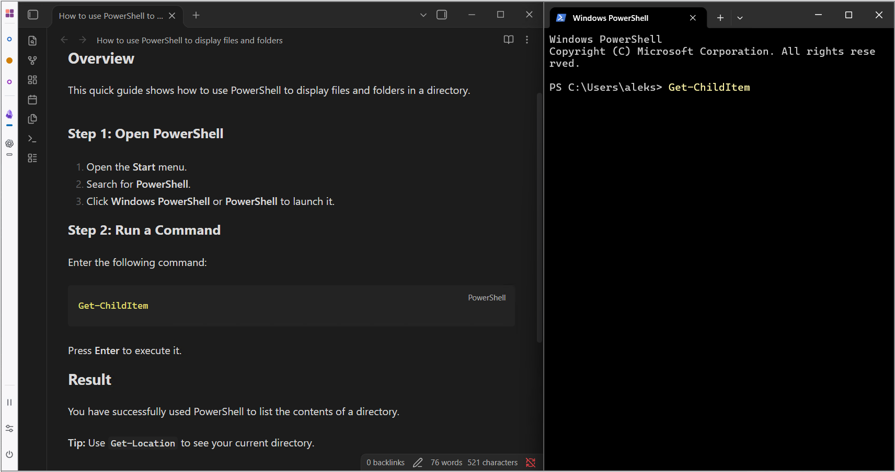
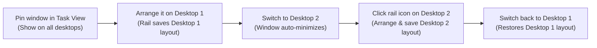

# Virtual Desktop Rail

A tiny Windows 11 side rail for **windows pinned across all virtual desktops** — keeping them one click away everywhere without cluttering every screen.

**Switch desktop → pinned windows get out of the way → switch back → get that desktop's exact layout back.**

> **Note:** This is an unsigned development preview.

## The problem it solves

When you use multiple virtual desktops (for example: one for coding, one for meetings, one for browsing), you usually have a few apps you want available on *every* desktop—like Obsidian, Slack, or Spotify.

Windows has a built-in feature for this: right-clicking a window in Task View (`Win + Tab`) and choosing **Show this window on all desktops**. That sounds great until you actually use it:

- **Screen clutter:** A window shown on all desktops stays open and visible everywhere, covering the work you are trying to do on other desktops.
- **One layout for everything:** If you want your notes maximized on Desktop 1, tucked in a corner on Desktop 2, and out of sight on Desktop 3, Windows forces the exact same size and position everywhere.

## How it works

Virtual Desktop Rail adds a narrow bar to the left edge of your primary monitor:

1. **Pin once in Windows:** Mark any window or app with **Show on all desktops** in Windows Task View (`Win + Tab`). Its icon shows up on the rail.
2. **Arrange per desktop:** Position or resize the window however you like on the current desktop. The rail remembers that layout for this desktop only.
3. **Switch desktops cleanly:** When you move to another desktop, the rail automatically minimizes those all-desktop windows so your new workspace stays clean (or optionally restores the layout you saved for that desktop).
4. **One-click toggle:** Click an app icon on the rail to restore its layout for the current desktop, bring it to the front, or minimize it again.

Enable **Tint rail with active desktop color** in Settings for a subtle background tint matching the current desktop dot. It is off by default.

### Quick controls

- **Top dots:** Your virtual desktops. Click to switch; hover to see the desktop name. Right-click a dot to rename it without switching desktops (or press **F2** while the dot has keyboard focus). Enter saves; Escape or clicking outside cancels. Names are shared with Windows Task View.
- **App icons:** Your all-desktop windows (solid bar underneath = visible; outlined bar = minimized). Click to restore, focus, or minimize.
- **Vertical name:** The current desktop name appears softly above the bottom buttons when there is room to show it in full. Turn it off with **Settings → Appearance → Show desktop name** (on by default).
- **Bottom buttons:** Use the **light switch** above Pause to toggle Windows light/dark colors for apps and the system, **Pause/Resume** automatic window actions, open **Settings** (to enable automatic layout restore on desktop switch or start with Windows), or **Exit** the app.

> *[Placeholder: Annotated diagram or close-up screenshot of the rail calling out: (1) Desktop dots, (2) Pinned app icons with solid/outlined visibility indicators, and (3) Light switch, Pause/Resume, Settings, and Exit buttons at the bottom.]*

## Requirements

- **Windows 11 x64**, version 24H2 (build **26100.2605** or newer).

## Installation and updates

1. Download the portable Windows x64 ZIP from the project's releases (or grab the `VirtualDesktopRail-windows-x64-<commit>` artifact from the latest `main` GitHub Actions run).
2. Extract the ZIP into a folder.
3. Run `virtual-desktop-rail.exe`.

**Updating:** Click **Exit** at the bottom of the rail, extract the new ZIP over your folder, and start `virtual-desktop-rail.exe` again. (If you moved the folder and use **Start with Windows**, toggle that setting off and back on in Settings.)

**Uninstalling:** Turn off **Start with Windows** in Settings, exit the app, and delete the folder. To also wipe saved layouts and settings, delete `%LOCALAPPDATA%\VirtualDesktopRail`.

## Getting started

1. Press `Win + Tab` to open **Task View**.
2. Right-click a window you want to share across desktops and select **Show this window on all desktops** (or **Show windows from this app on all desktops**).
3. The window's icon appears on the left rail.
4. Arrange the window on your current desktop.
5. Switch to a second desktop. The window minimizes automatically. Click its icon on the rail and place it where you want it on this desktop.
6. Switch back to the first desktop and click the icon—it returns to your first desktop's layout.

*Tip: Want your pinned windows to pop into place automatically when you switch desktops without clicking? Open **Settings** (the sliders icon on the rail) and turn on **Restore saved layouts on desktop switch**.*

<!-- repository-links:start -->
## Documentation and contributing

- **Detailed usage & troubleshooting:** See the [User Guide](docs/USER_GUIDE.md) for all rail controls, Windows Snap behavior, troubleshooting tips, diagnostic reports, and build version inspection.
- **Contributing:** For building from source, architecture, testing, and implementation status, start with the [contributor documentation](.devdocs/README.md).
<!-- repository-links:end -->
